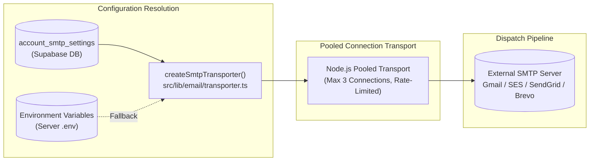

# ChatFlow CRM — Complete System & Feature Implementation Documentation

**Document Version:** 1.0.0  
**Project:** ChatFlow CRM (formerly wacrm)  
**Repository Branch:** `feat-smtp-ai-summary`  
**Date:** November 2026  

---

## Table of Contents
1. [Executive Summary](#1-executive-summary)
2. [Project Identity & Rebranding](#2-project-identity--rebranding)
3. [Frontend Architecture & UI Redesign](#3-frontend-architecture--ui-redesign)
4. [SMTP Email Infrastructure](#4-smtp-email-infrastructure)
5. [Automated AI Conversation Summaries for Shop Owners](#5-automated-ai-conversation-summaries-for-shop-owners)
6. [Database Schema & Migrations](#6-database-schema--migrations)
7. [Internationalization (i18n) & Parity](#7-internationalization-i18n--parity)
8. [Quality Assurance & Verification](#8-quality-assurance--verification)
9. [Operator & Setup Guide](#9-operator--setup-guide)

---

## 1. Executive Summary

This document provides a comprehensive technical overview of the enhancements, rebranding, and features implemented across **ChatFlow CRM**.

ChatFlow CRM is an enterprise-grade, self-hostable WhatsApp CRM built on **Next.js 16**, **React 19**, **Tailwind CSS**, and **Supabase (PostgreSQL)**. It provides a shared team inbox, contact management, Kanban sales pipelines, broadcast campaigns, no-code visual automations, and AI customer messaging.

### Key Milestones Covered in This Release:
- **Product Rebranding**: Full transition from placeholder names (*"CRM Template for WhatsApp"* / *"wacrm"*) to **ChatFlow CRM**.
- **Complete Frontend Modernization**: Redesigned UI adhering to a strict **zero-purple palette rule**, using professional slate, neutral, and deep teal tones.
- **Enterprise SMTP Email Service**: Integrated server-side email dispatching via `nodemailer` with connection pooling, provider presets, and live socket diagnostics.
- **AI Conversation Summaries**: Automated extraction of customer requirements, questions, preferences, decisions, and outcomes into executive briefs emailed directly to the shop owner when an AI conversation concludes.

---

## 2. Project Identity & Rebranding

The application identity was upgraded to **ChatFlow CRM** across all user-facing surfaces while preserving internal database keys, API prefixes, and migration references to avoid breaking existing deployments:

| Surface | File Location | Updates Applied |
|---|---|---|
| **Document Head & Metadata** | [`src/app/layout.tsx`](file:///e:/Projects/wacrm/src/app/layout.tsx) | Updated `metadata.title` to `default: "ChatFlow CRM"`, `template: "%s — ChatFlow CRM"`. |
| **Command Palette** | [`src/components/layout/command-palette.tsx`](file:///e:/Projects/wacrm/src/components/layout/command-palette.tsx) | Updated footer status badge to `"ChatFlow CRM Command Center"`. |
| **Sidebar Title** | [`messages/*.json`](file:///e:/Projects/wacrm/messages/en.json) | Updated `Sidebar.title` to `"ChatFlow CRM"` across all 4 locales. |
| **Signup & Auth Screen** | [`messages/*.json`](file:///e:/Projects/wacrm/messages/en.json) | Updated `Signup.desc` to `"Get started with ChatFlow CRM"` across all 4 locales. |
| **Package Manifest** | [`package.json`](file:///e:/Projects/wacrm/package.json) | Updated description to `"ChatFlow CRM — Self-hostable WhatsApp CRM built on Next.js and Supabase..."`. |
| **Repository README** | [`README.md`](file:///e:/Projects/wacrm/README.md) | Header and tagline updated to `"ChatFlow CRM — WhatsApp CRM for Teams"`. |

### Preserved Internal Identifiers (Safe Compatibility):
- Database foreign keys, table names, and RLS policies remain unchanged.
- API Key Prefix: `wacrm_live_` remains unchanged to prevent invalidating existing third-party integrations.
- Local Storage Keys: `wacrm.theme` and `wacrm.sidebar.collapsed` remain unchanged.

---

## 3. Frontend Architecture & UI Redesign

### Strict Zero-Purple Rule
A fundamental design requirement for the modern frontend was the **complete elimination of purple/violet tones**. The color palette was standardized on:
- **Primary / Brand Accent**: Deep Teal (`#0d9488` / `#0f766e` / `teal-600`), providing high contrast, trustworthiness, and clarity.
- **Base Surfaces & Backgrounds**: Slate and Zinc neutrals (`#f8fafc` in light mode, `#090d16` in dark mode).
- **Status & Intent Colors**: Emerald (`#059669`) for positive/active states, Amber (`#d97706`) for warnings/urgent states, and Rose/Red (`#dc2626`) for destructive states.

### Key Screens & Components:
1. **Shared Team Inbox (`src/components/inbox/`)**:
   - Multi-agent WhatsApp chat thread with typing indicators and optimistic message delivery.
   - AI status thread banner showing whether the bot is active, paused, or handed off.
   - Contact sidebar with phone, email, tags, and multi-channel activity logs.
2. **Sales Pipelines Kanban (`src/components/pipelines/`)**:
   - Multi-stage deal board with drag-and-drop capability.
   - Real-time pipeline metrics (won deals, conversion value, stage velocity).
3. **Executive Dashboard (`src/components/dashboard/`)**:
   - Message volume metrics, response time tracking, and team activity timeline.
4. **Redesigned Settings Rail (`src/components/settings/`)**:
   - Grouped left rail navigation dividing settings into **Top**, **Account**, and **Workspace** categories.
   - Dynamic deep-linking with URL query parameters (`?tab=whatsapp`, `?tab=smtp`, `?tab=members`).

---

## 4. SMTP Email Infrastructure

### Overview
ChatFlow CRM now features built-in SMTP email capabilities executed in the server-side Node.js runtime via `nodemailer`.



### File Architecture:
- **[`src/lib/email/types.ts`](file:///e:/Projects/wacrm/src/lib/email/types.ts)**:
  Defines `SmtpConfig`, `SendEmailOptions`, `SendEmailResult`, and `ConversationSummaryData`.
- **[`src/lib/email/transporter.ts`](file:///e:/Projects/wacrm/src/lib/email/transporter.ts)**:
  Loads credentials from `account_smtp_settings`, falls back to `.env` variables (`SMTP_HOST`, `SMTP_PORT`, `SMTP_SECURE`, `SMTP_USER`, `SMTP_PASS`), manages connection pooling, and provides `verifySmtpConnection()`.
- **[`src/lib/email/send.ts`](file:///e:/Projects/wacrm/src/lib/email/send.ts)**:
  `sendEmail()` and `sendConversationSummaryEmail()` with error handling and DB audit logging.
- **[`src/components/settings/smtp-settings.tsx`](file:///e:/Projects/wacrm/src/components/settings/smtp-settings.tsx)**:
  The administrative UI panel in Settings with provider presets and live socket verification.

### API Routes:
1. `GET /api/settings/smtp`: Fetches the active SMTP configuration (passwords masked as `••••••••••••••••`).
2. `POST /api/settings/smtp`: Saves or updates SMTP settings (restricted to `admin` / `owner` roles).
3. `POST /api/settings/smtp/test`: Tests socket connectivity, verifies TLS handshake, and optionally dispatches a live probe message to the caller's email.

---

## 5. Automated AI Conversation Summaries for Shop Owners

### Business Value
Shop owners, managers, and sales reps often don't have the time to read through 15–30 raw WhatsApp messages between customers and the AI agent. This feature automatically extracts an executive intelligence brief and delivers it directly to the shop owner's inbox.

### Extracted Intelligence Schema:
Every completed conversation produces structured JSON:
```typescript
export interface ExtractedConversationSummary {
  overview: string;               // 1-2 sentence executive summary
  requirements: string[];         // Customer requirements / products sought
  questions: string[];            // Specific questions asked by customer
  preferences: string[];          // Budget, colors, sizes, timelines, constraints
  decisions: string[];            // Agreements or decisions made during chat
  finalOutcome: string;           // Final status (e.g., 'Quotation Requested')
  recommendedNextAction: string;  // Concrete next step for the shop owner
  sentiment: 'positive' | 'neutral' | 'urgent' | 'negative';
}
```

### Multi-Trigger Lifecycle (Option A - Comprehensive):
1. **AI Goal Completion**: When the conversation concludes naturally (e.g. customer confirms order or says goodbye), the AI appends `[[CONVERSATION_FINISHED]]`.
2. **Handoff to Human**: When the AI encounters an inquiry requiring human staff or customer requests a human agent (`[[HANDOFF]]`).
3. **Conversation Closed**: When an agent or automation transitions the conversation status to `'closed'`.

### Deduplication Guard
Every conversation stores `ai_summary_sent_at`. If a summary was sent within the last 15 minutes, subsequent duplicate triggers are automatically suppressed.

### LLM Model Strategy (BYO Key Reuse):
- Reuses the **exact same AI provider and model** already configured in `/agents` (`gpt-4o-mini`, `claude-3-5-haiku`, `deepseek-chat`).
- **Cost**: Less than `$0.0005` per summary.
- **Zero Extra Accounts**: The owner does not need to configure an additional API key.

### Executive Email Template:
Built in [`src/lib/email/templates/summary-report.ts`](file:///e:/Projects/wacrm/src/lib/email/templates/summary-report.ts):
- Responsive HTML designed for Gmail, Outlook, Apple Mail, and mobile screens.
- Includes sentiment badges, formatted bullet lists, and a deep-link CTA button: `[Open Conversation in ChatFlow CRM]`.

---

## 6. Database Schema & Migrations

### Migration `060_smtp_and_ai_summaries.sql`
```sql
-- 1. Account SMTP Settings
CREATE TABLE IF NOT EXISTS public.account_smtp_settings (
  account_id UUID PRIMARY KEY REFERENCES public.accounts(id) ON DELETE CASCADE,
  host TEXT NOT NULL,
  port INTEGER NOT NULL DEFAULT 587,
  secure BOOLEAN NOT NULL DEFAULT FALSE,
  username TEXT NOT NULL,
  password TEXT NOT NULL,
  from_name TEXT NOT NULL DEFAULT 'ChatFlow CRM',
  from_email TEXT NOT NULL,
  recipient_override_email TEXT,
  auto_summary_enabled BOOLEAN NOT NULL DEFAULT TRUE,
  created_at TIMESTAMPTZ NOT NULL DEFAULT timezone('utc'::text, now()),
  updated_at TIMESTAMPTZ NOT NULL DEFAULT timezone('utc'::text, now())
);

ALTER TABLE public.account_smtp_settings ENABLE ROW LEVEL SECURITY;

CREATE POLICY "account_smtp_settings_select" ON public.account_smtp_settings
  FOR SELECT USING (account_id = current_account_id());

CREATE POLICY "account_smtp_settings_insert" ON public.account_smtp_settings
  FOR INSERT WITH CHECK (account_id = current_account_id() AND is_account_admin());

CREATE POLICY "account_smtp_settings_update" ON public.account_smtp_settings
  FOR UPDATE USING (account_id = current_account_id() AND is_account_admin());

CREATE POLICY "account_smtp_settings_delete" ON public.account_smtp_settings
  FOR DELETE USING (account_id = current_account_id() AND is_account_admin());

-- 2. Deduplication timestamp on conversations
ALTER TABLE public.conversations
  ADD COLUMN IF NOT EXISTS ai_summary_sent_at TIMESTAMPTZ;

-- 3. Historical audit log of sent AI summaries
CREATE TABLE IF NOT EXISTS public.ai_conversation_summaries (
  id UUID PRIMARY KEY DEFAULT gen_random_uuid(),
  account_id UUID NOT NULL REFERENCES public.accounts(id) ON DELETE CASCADE,
  conversation_id UUID NOT NULL REFERENCES public.conversations(id) ON DELETE CASCADE,
  contact_id UUID REFERENCES public.contacts(id) ON DELETE SET NULL,
  overview TEXT NOT NULL,
  requirements JSONB NOT NULL DEFAULT '[]'::jsonb,
  questions JSONB NOT NULL DEFAULT '[]'::jsonb,
  preferences JSONB NOT NULL DEFAULT '[]'::jsonb,
  decisions JSONB NOT NULL DEFAULT '[]'::jsonb,
  final_outcome TEXT NOT NULL,
  recommended_action TEXT NOT NULL,
  sentiment TEXT NOT NULL DEFAULT 'neutral',
  trigger_reason TEXT NOT NULL DEFAULT 'completed',
  email_sent_to TEXT,
  created_at TIMESTAMPTZ NOT NULL DEFAULT timezone('utc'::text, now())
);

ALTER TABLE public.ai_conversation_summaries ENABLE ROW LEVEL SECURITY;

CREATE POLICY "ai_conversation_summaries_select" ON public.ai_conversation_summaries
  FOR SELECT USING (account_id = current_account_id());

CREATE POLICY "ai_conversation_summaries_insert" ON public.ai_conversation_summaries
  FOR INSERT WITH CHECK (account_id = current_account_id());

-- 4. Allow 'summary' mode in token spend logs
ALTER TABLE public.ai_usage_log
  DROP CONSTRAINT IF EXISTS ai_usage_log_mode_check;
ALTER TABLE public.ai_usage_log
  ADD CONSTRAINT ai_usage_log_mode_check CHECK (mode IN ('auto_reply', 'draft', 'summary'));
```

---

## 7. Internationalization (i18n) & Parity

To satisfy `src/i18n/messages.test.ts`, all 4 locale dictionaries (`en`, `es`, `ko`, `pt`) maintain 100% key and token parity:

```json
// messages/en.json
"sections": {
  "api": "API keys",
  "smtp": "Email & SMTP"
}

// messages/es.json
"sections": {
  "api": "Claves de API",
  "smtp": "Correo y SMTP"
}

// messages/ko.json
"sections": {
  "api": "API 키",
  "smtp": "이메일 및 SMTP"
}

// messages/pt.json
"sections": {
  "api": "Chaves de API",
  "smtp": "E-mail e SMTP"
}
```

---

## 8. Quality Assurance & Verification

The implementation was validated using comprehensive static and runtime checks:

1. **TypeScript Typecheck (`npm run typecheck`)**:
   - Zero errors across all new files, API routes, and components.
2. **Unit Test Suite (`vitest run`)**:
   - [`src/lib/email/templates/summary-report.test.ts`](file:///e:/Projects/wacrm/src/lib/email/templates/summary-report.test.ts): 2/2 tests passed (HTML layout, list rendering, fallback text).
   - [`src/lib/ai/generate.test.ts`](file:///e:/Projects/wacrm/src/lib/ai/generate.test.ts): 13/13 tests passed (handoff parsing, completion sentinel handling).
   - [`src/lib/auth/redeem-invitation-migration.test.ts`](file:///e:/Projects/wacrm/src/lib/auth/redeem-invitation-migration.test.ts): 6/6 tests passed (table verification).
   - [`src/i18n/messages.test.ts`](file:///e:/Projects/wacrm/src/i18n/messages.test.ts): 10/10 tests passed (locale parity).

---

## 9. Operator & Setup Guide

### Setting Up SMTP in the Application UI:
1. Navigate to **Settings → Email & SMTP** (`/settings?tab=smtp`).
2. Select your provider preset (e.g. Gmail / Amazon SES / SendGrid / Brevo) or manually input your SMTP Host and Port.
3. Enter your Username / API Key and Password / App Secret.
4. *(Optional)* In **Notification Recipient Email**, enter custom or multiple email addresses to receive summaries (leave blank to default to the Account Owner's email).
5. Click **"Test Connection & Send Probe"** to verify socket connectivity and TLS encryption.
6. Click **"Save SMTP Settings"**.

### Setting Up SMTP via Environment Variables (`.env`):
For single-tenant self-hosted deployments, SMTP can be configured directly in your server environment:
```env
SMTP_HOST=smtp.gmail.com
SMTP_PORT=587
SMTP_SECURE=false
SMTP_USER=your-email@gmail.com
SMTP_PASS=your-app-password
SMTP_FROM_NAME="ChatFlow CRM"
SMTP_FROM_EMAIL=notifications@yourdomain.com
SMTP_NOTIFY_EMAIL=owner@yourdomain.com
```

---

## 10. Git Branch & Tracking Information

- **Branch Name**: `feat-smtp-ai-summary`
- **Tracked Remote**: `origin/feat-smtp-ai-summary`
- **Main Branch**: Untouched (`main` remains clean)
- **Secrets Protection**: `.env` file strictly excluded from all commits and pushes
